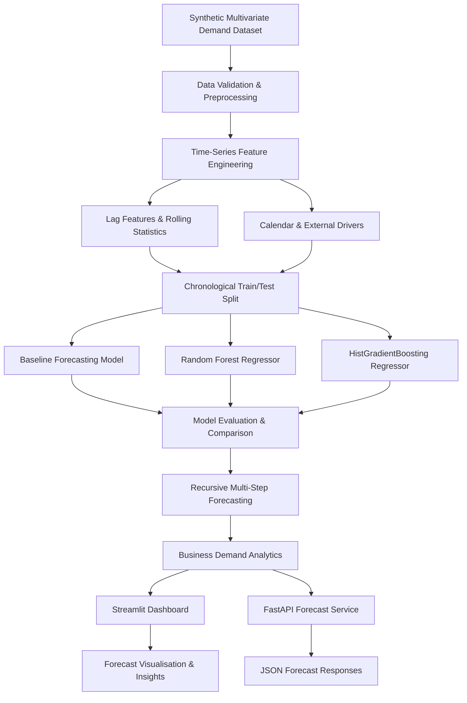

# Multivariate Time-Series Forecasting for Business Demand Planning

An AI-powered demand forecasting system designed to analyse historical business demand alongside calendar, pricing, promotional, weather, and product-related variables to predict future demand and support data-driven inventory and capacity planning. The platform integrates time-aware feature engineering, machine learning-based forecasting, chronological model evaluation, and recursive multi-step prediction. It includes an interactive Streamlit dashboard and FastAPI REST service for exploring demand patterns, comparing forecasting models, and generating future demand estimates.

> **Data Notice:** The included dataset is synthetically generated for demonstration and testing. Weather conditions, holidays, prices, promotions, and demand observations are simulated and do not represent actual business operations or market conditions. Forecasts are experimental estimates and are not validated for operational planning.

## Key Features

- **Synthetic Multivariate Dataset Generation:** Creates reproducible daily demand observations across multiple products and stores.
- **Time-Series Preprocessing:** Validates dates, product identifiers, store information, and numerical variables.
- **Time-Aware Feature Engineering:** Generates lag features, rolling statistics, calendar variables, and external demand drivers.
- **Multiple Forecasting Models:** Implements baseline forecasting, Random Forest, and HistGradientBoosting models.
- **Chronological Data Splitting:** Separates training and testing observations according to time to reduce temporal data leakage.
- **Model Performance Comparison:** Evaluates forecasting accuracy using MAE, RMSE, and R².
- **Recursive Multi-Step Forecasting:** Generates future demand estimates using previously predicted values as inputs where applicable.
- **Business Demand Analytics:** Explores demand patterns across products, stores, categories, and time periods.
- **Interactive Dashboard:** Provides forecast visualisation, product and store selection, and model comparison through Streamlit.
- **REST API Integration:** Exposes forecasting functionality through FastAPI.
- **Reproducible Experiments:** Includes data generation scripts, exploratory notebooks, documentation, and unit tests.

## System Architecture



## Dataset Description

The system uses a synthetic multivariate daily demand dataset containing observations across multiple products and retail stores.

### Dataset Features

| Feature | Description |
|---|---|
| `date` | Date of the demand observation |
| `store_id` | Unique store identifier |
| `product_id` | Unique product identifier |
| `category` | Product category |
| `price` | Product selling price |
| `promotion` | Promotion or discount indicator |
| `temperature` | Simulated temperature value |
| `holiday` | Holiday indicator |
| `demand` | Observed or synthetically generated demand |

The combination of historical demand and external variables provides a structured foundation for multivariate forecasting experiments.

## Core Analytical Modules

### 1. Data Generation and Preprocessing

Creates and prepares structured demand observations for forecasting.

- Synthetic daily demand generation
- Multiple product and store combinations
- Date validation and chronological ordering
- Missing-value handling
- Duplicate observation checks
- Numerical and categorical feature preparation
- Reproducible dataset creation

### 2. Time-Series Feature Engineering

Transforms historical observations and contextual variables into predictive features.

**Lag Features**
- Previous-day demand
- Previous-week demand
- Previous-month demand, where supported by the observation frequency

**Rolling Statistics**
- Rolling demand mean
- Rolling demand standard deviation
- Rolling demand minimum and maximum

**Calendar Features**
- Day of the week
- Month
- Week of the year
- Weekend indicator
- Holiday indicator

**External Drivers**
- Product price
- Promotion status
- Simulated temperature
- Product category
- Store identifier

Feature construction must use only information available at the forecast origin. Rolling statistics should be shifted appropriately to avoid incorporating the target observation into its own predictors.

### 3. Machine Learning-Based Demand Forecasting

Implements and compares multiple forecasting approaches to estimate future product demand.

**Implemented model families:**

| Model | Approach |
|---|---|
| Baseline Forecasting | Reference prediction for performance comparison |
| Random Forest Regressor | Ensemble learning using decision trees |
| HistGradientBoosting Regressor | Gradient-boosted decision trees for regression |

The forecasting pipeline uses historical demand and engineered explanatory variables to estimate future demand.

### 4. Chronological Model Evaluation

Uses time-based data splitting to simulate forecasting on unseen future observations.

**Evaluation workflow:**

1. Sort observations by date.
2. Separate earlier observations for training.
3. Reserve later observations for testing.
4. Generate predictions on the test period.
5. Calculate forecasting evaluation metrics.
6. Compare model performance.

This approach helps reduce the risk of temporal leakage that can occur with random train/test splitting.

### 5. Recursive Multi-Step Forecasting

Generates forecasts across multiple future time steps.

**Forecasting workflow:**

1. Load the latest available historical observations.
2. Construct the required lag and rolling features.
3. Generate the next-step demand prediction.
4. Add the prediction to the forecast history.
5. Recalculate relevant features.
6. Repeat the process for the required forecasting horizon.

**Important:** Recursive forecasting can accumulate prediction errors because earlier predictions become inputs for later forecast steps. Forecast quality should therefore be evaluated across the entire forecasting horizon.

### 6. Business Demand Planning Analytics

Transforms forecasting outputs into insights that can support operational planning.

- Product-level demand analysis
- Store-level demand comparison
- Category-wise demand trends
- Historical versus forecast demand visualisation
- Promotion and pricing impact exploration
- Demand variability analysis
- Future inventory and capacity planning support

Forecasts can inform planning discussions but should not be treated as guaranteed sales or inventory requirements.

### 7. Interactive Forecasting Dashboard

The Streamlit dashboard provides an interface for exploring demand patterns and model predictions.

- Overall demand overview and KPI summaries
- Product and store selection
- Historical demand visualisation
- Future demand forecasts
- Forecasting model comparison
- Actual versus predicted demand analysis
- Model evaluation metrics
- Interactive date and product filters

## Technology Stack

| Category | Technologies |
|---|---|
| Programming Language | Python |
| Data Processing | Pandas, NumPy |
| Machine Learning | Scikit-learn |
| Forecasting Models | Baseline, Random Forest, HistGradientBoosting |
| Time-Series Analysis | Lag Features, Rolling Statistics |
| Data Visualisation | Matplotlib, Plotly |
| Dashboard | Streamlit |
| Backend API | FastAPI, Uvicorn |
| Data Format | CSV, JSON |
| Model Persistence | Joblib |
| Testing | Pytest |
| Development Environment | Jupyter Notebook, VS Code |
| Version Control | Git, GitHub |

## Quick Start

### Prerequisites

- Python 3.10 or later
- pip package manager
- Git (optional)

### 1. Clone the Repository

```bash id="3p8m2v"
git clone <repository-url>
cd <repository-folder>
```

### 2. Create a Virtual Environment

```bash id="7k4x9q"
python -m venv venv
```

**Windows:**
```bash id="2m6w8p"
venv\Scripts\activate
```

**macOS / Linux:**
```bash id="5q1n7v"
source venv/bin/activate
```

### 3. Install Dependencies

```bash id="9x3p6m"
pip install -r requirements.txt
```

### 4. Generate the Synthetic Demand Dataset

```bash id="4v8k2q"
python scripts/generate_data.py
```

### 5. Train the Forecasting Models

```bash id="6n2w5p"
python scripts/train_model.py
```

### 6. Launch the Streamlit Dashboard

```bash id="1m9q4x"
streamlit run app/streamlit_app.py
```

Open the local URL displayed in the terminal to access the demand forecasting dashboard.

> **Note:** The commands above assume the example script and application paths exist in the repository. Adjust them to match the actual implementation.

## FastAPI Integration

The project includes a lightweight REST API for accessing demand forecasting functionality.

### Start the API Server

```bash id="8p3x6n"
uvicorn api.main:app --reload
```

### Access Interactive API Documentation

Open Swagger UI:

```text id="4q7m2v"
http://127.0.0.1:8000/docs
```

### API Capabilities

- API health checks
- Product-level demand forecasting
- Store-level forecast requests
- Multi-step forecast generation
- JSON-based prediction responses

The actual endpoint names, supported parameters, and response schemas should match the implemented FastAPI service.

## Model Evaluation

The forecasting models are evaluated using standard regression metrics.

| Metric | Purpose |
|---|---|
| MAE | Measures average absolute prediction error |
| RMSE | Penalises larger prediction errors more strongly |
| R² Score | Measures the proportion of target variance explained by the model |

**Evaluation considerations:**

- Use chronological train/test splitting.
- Avoid future information in lag and rolling features.
- Compare models using consistent test periods.
- Evaluate performance across different products and stores where sufficient data is available.
- Examine forecast errors across different prediction horizons.
- Compare machine-learning models against a simple baseline.
- Report actual experimental results rather than assumed performance.

Synthetic-data evaluation demonstrates model implementation and experimental behaviour, not proven real-world forecasting accuracy.

## Project Structure

```text id="6w2p9m"
Multivariate_Demand_Forecasting/
│
├── api/
│   └── main.py                  # FastAPI forecasting endpoint
│
├── app/
│   └── streamlit_app.py         # Interactive dashboard
│
├── data/
│   └── synthetic_demand.csv     # Multivariate demand dataset
│
├── docs/
│   ├── methodology.md           # Forecasting methodology
│   └── data_dictionary.md       # Dataset documentation
│
├── notebooks/
│   └── exploratory_analysis.ipynb
│
├── scripts/
│   ├── generate_data.py         # Synthetic data generation
│   └── train_model.py           # Model training pipeline
│
├── src/
│   ├── preprocessing.py          # Data preparation
│   ├── feature_engineering.py    # Time-series features
│   ├── baseline_model.py         # Baseline forecasting
│   ├── random_forest.py          # Random Forest model
│   ├── gradient_boosting.py      # HistGradientBoosting model
│   ├── forecasting.py            # Multi-step forecasting
│   └── evaluation.py              # Model evaluation
│
├── tests/                        # Unit tests
│
├── requirements.txt
└── README.md
```

*This is a suggested repository layout. Retain the actual filenames and modules implemented in your project.*

## Limitations

- The bundled demand dataset is synthetically generated.
- Weather, holiday, promotion, and price variables are simulated rather than collected from actual business operations.
- Model performance on synthetic observations does not establish real-world forecasting accuracy.
- Recursive multi-step forecasts can accumulate prediction errors.
- Random Forest and HistGradientBoosting models do not automatically capture all temporal dependencies.
- External factors such as supply disruptions, competitor actions, economic conditions, and unexpected events may not be represented.
- Forecasts do not guarantee improved inventory availability, reduced costs, or increased revenue.
- Operational deployment requires reliable business data, robust backtesting, uncertainty estimates, and continuous monitoring.

## Responsible Use

- Use this project strictly for educational, research, and portfolio demonstration purposes.
- Ensure datasets are legally obtained and comply with applicable data privacy requirements.
- Protect confidential business and customer information.
- Treat forecasts as decision-support estimates rather than guaranteed outcomes.
- Validate model performance across multiple time periods before operational use.
- Monitor forecasting errors and changes in demand patterns.
- Maintain human oversight when using predictions for inventory, procurement, or capacity decisions.

## Future Enhancements

- Advanced forecasting models such as XGBoost and LightGBM
- LSTM and GRU-based deep learning architectures
- Transformer-based time-series forecasting
- Multi-horizon direct forecasting
- Prediction intervals and uncertainty estimation
- Advanced seasonality and holiday modelling
- Automated model selection and hyperparameter tuning
- Hierarchical forecasting across products, categories, and stores
- Inventory optimisation and safety stock estimation
- Real-time demand data ingestion
- Model drift detection and forecasting performance monitoring
- Docker-based deployment and cloud integration

## Author

**Mohamed Riyaz S.**  
Integrated M.Tech – Computer Science and Engineering (Business Analytics)  
Vellore Institute of Technology (VIT), Chennai
